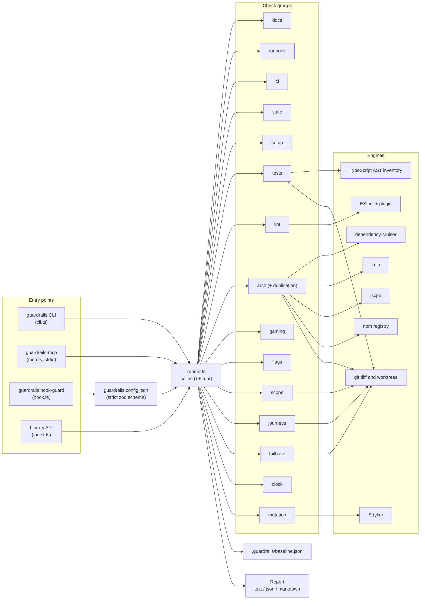

# @ws42ca/guardrails: knowledge base

A single reference for what `@ws42ca/guardrails` does, how its parts fit together, and how to use it day to day. It describes version 0.6.2. For a short introduction see `README.md`; for the full list of rules see `RULES.md`; for the testing policy the rules enforce see `TESTING.md`. Every statement here comes from the package source, so when this file and the code disagree, the code wins.

## Contents

1. [What it is and who it is for](#1-what-it-is-and-who-it-is-for)
2. [Feature catalogue](#2-feature-catalogue)
3. [Architecture](#3-architecture)
4. [Getting started](#4-getting-started)
5. [Working with coding agents day to day](#5-working-with-coding-agents-day-to-day)
6. [Configuration reference](#6-configuration-reference)
7. [Journeys (CUJs) guide](#7-journeys-cujs-guide)
8. [Troubleshooting and FAQ](#8-troubleshooting-and-faq)
9. [Release and publishing notes for maintainers](#9-release-and-publishing-notes-for-maintainers)
10. [Glossary](#10-glossary)

---

## 1. What it is and who it is for

Coding agents optimise for a green build. Left alone they delete the failing test, loosen an assertion, special-case the expected value, add a package that does not exist, or write a new document for every task. `guardrails` is a config-driven checker that blocks those shortcuts in CI and inside the agent's own editor.

It ships as:

| Piece | Binary or path | Purpose |
|---|---|---|
| CLI | `guardrails` | Run checks, record baselines, scaffold a project, run journeys, small CI helpers |
| MCP server | `guardrails-mcp` (stdio) | Lets an agent run the checks and ask questions before it commits |
| Agent hooks | `guardrails hook-guard` | Denies agent edits to locked files |
| Agent skill | `skill/SKILL.md` | Instructions that tell an agent how to work under the rules |
| Vitest setup | `@ws42ca/guardrails/vitest-setup` | Makes every test assert something (TEST-9) |
| Library | `@ws42ca/guardrails` (ESM) | The same engine, programmatically (feature F-57) |
| Config | `guardrails.config.json` | The single configuration file per project, with a JSON schema |

**Who it is for**

- Teams that let AI coding agents (Claude Code, Gemini CLI, Antigravity, Codex CLI and other tools) change a codebase and want the tests, docs and architecture to stay honest.
- Maintainers who want a human code owner, not the agent, to decide what gets tested and what the rules are.
- Owners of small static sites who want product-level checks (journeys, links, smoke tests) with very little setup.

**What it assumes**

- Node 20 or newer (`engines.node` is `>=20`).
- A git repository with full history in CI (diff rules compare against the merge base of a base branch).
- TypeScript or JavaScript source. Test discovery, the ESLint bans and the mutation engine target Vitest-style tests; Vitest, `@stryker-mutator/core` and `@stryker-mutator/vitest-runner` are optional peer dependencies.
- GitHub for the label and CODEOWNERS workflow. Nothing else in the CLI talks to GitHub.

**What it is not**

- It is not a test runner. It reads tests, and for a few rules it runs your test command (`tests.command`).
- It does not scan for secrets itself. SEC-1 is a gitleaks step in CI.
- It does not call a model during checks. The one exception is the optional `journeys draft` command.

---

## 2. Feature catalogue

Each feature lists what it does, the command or config that controls it, and its default. "Diff" means the feature only runs when a base ref is available (`--base <ref>`, or `GITHUB_BASE_REF` on pull-request runs). Rule IDs link to `RULES.md`, which has the why and the fix for every rule; `guardrails explain <ID>` prints the same text.

There are 47 rules (`guardrails explain` lists them). Features below group them by what they protect.

### A. Test integrity

| # | Feature | What it does | Command or config | Default |
|---|---|---|---|---|
| F-01 | **Spec IDs on tests** (TEST-1) | Every `it`/`test` title, or the `describe` around it, must start with a spec ID such as `ORDER-01`. An ID that is malformed or not in `specs.items` blocks; a missing ID only warns. Titles are read with a TypeScript AST, not a regex. | `specs.idPattern`, `specs.items` | block (missing ID: warn) |
| F-02 | **Risk tiers and coverage of risky specs** (TEST-2) | Specs have a tier (T1, T2, T3). A T1 spec with no test blocks, a T2 spec warns, T3 is optional. Specs listed in `holdout.specs` are exempt because their tests are hidden. | `specs.items.<ID>.tier`, `tiers` | block for T1, warn for T2 |
| F-03 | **Test padding limits** (TEST-4) | Warns when a test file passes the line cap or one spec ID has more tests than the cap (use `it.each` instead). | `tests.maxFileLines`, `specs.maxTestsPerId` | 300 lines, 8 tests per ID, warn |
| F-04 | **Test budget** (TEST-3, diff) | Compares added test lines with added product lines per tier. Over the budget warns. Never blocks on its own. | `tests.budget` | T1 1.0, T2 0.6, T3 0.4, warn |
| F-05 | **Banned test patterns** (TEST-5) | An ESLint run with its own fixed config (your ESLint config is not used and inline `eslint-disable` comments are ignored). Blocks `.only`, `.skip`, `test.todo`, `each([])`, the real clock (`new Date()`, `Date.now()`, `performance.now()`, `process.hrtime`) unless the file fakes timers, unseeded randomness, fast-check runs that are not a small fixed run (20 runs or fewer), and `// Stryker disable` comments (also in product files). Warns on T1 snapshots, `toHaveClass`/`toHaveStyle`, hand-rolled `createServer`, spies on `Date`/`Response`/`crypto.subtle`/prototypes, generated-input loops over 20 iterations, and seeded fast-check runs outside specs marked `properties: true`. | `rules.TEST-5`, `specs.items.<ID>.properties` | block, with the warn-only items above |
| F-06 | **Weak assertion heuristics** (TEST-5W) | Warns when every assertion in a test is weak: no `expect` at all, only "a mock was called", or only `toBeDefined`/`toBeTruthy`/`not.toThrow`/`expect(true)`. | none | warn |
| F-07 | **Every test must assert** (TEST-9) | Checks the Vitest config's `setupFiles` for `@ws42ca/guardrails/vitest-setup` (the legacy `@ws42/guardrails/vitest-setup` name is also accepted) or a setup file that calls `expect.hasAssertions()`. The setup file itself runs `expect.hasAssertions()` before each test. | Vitest `setupFiles` | block |
| F-08 | **No test weakening** (TEST-7, diff) | On a PR, blocks deleting a test that exists on the base branch, removing `expect` calls from a test, loosening a matcher (for example `toEqual` to `toBeTruthy`), and lowering a coverage or mutation threshold in Vitest or Stryker config. A deleted test needs the `guardrails:tests-removed-approved` label. Tests added in the same PR can change freely, and moving a test between files is not a deletion. | label `tests-removed-approved` (`tests.testsRemovedLabel`) | block |
| F-09 | **Test count drop** (TEST-10, diff) | Warns when the total test count is below the base branch, listing the deleted tests in the report. | none | warn |
| F-10 | **New tests must fail on base** (TEST-11, diff) | Creates a temporary git worktree of the merge base, copies in the PR's changed test and helper files (and the config), runs `tests.command` on just those files on base and on head. A new or changed test must fail on base and pass on head. Escape hatches: the `guardrails:existing-behaviour-tests-approved` label (for new tests that lock in existing behaviour), or `regressionGuard: true` on the spec. | `check --base <ref> --fails-on-base`, `specs.items.<ID>.regressionGuard` | opt in by flag; block |
| F-11 | **Clock independence** (TEST-6) | Reruns the suite with the clock moved forward and blocks tests that pass today but fail then (the "time bomb" test). Fake timers still win. Per-test attribution needs a Vitest command; for other runners it only reports a failing shifted suite. | `check --clock-shift`, `tests.command`, `tests.clockShiftYears` | opt in by flag; +2 years; block |
| F-12 | **Mutation testing** (TEST-8) | Runs Stryker on changed product files in the chosen tiers (all files in those tiers when no base is given). Each file's mutation score must reach the break threshold. Stryker is generated config: pinned mutators, incremental, 2 workers, 60 s per mutant. If Stryker is not installed or no mutation-tier file changed, the check is skipped with a note, not failed. | `check --only mutation --mutation`, `mutation.*`, `guardrails mutants` | opt in by flag; T1 only; break at 70; block |

### B. Anti-gaming and agent control

| # | Feature | What it does | Command or config | Default |
|---|---|---|---|---|
| F-13 | **Test-gaming signatures** (ARCH-7) | Blocks product code that detects the test runner (`NODE_ENV === 'test'`, `VITEST`, `JEST_WORKER_ID`, `import.meta.vitest` and similar) or exits the process outside a CLI entry; blocks `expect.extend` in test files. In diff mode also blocks an added `valueOf`/`equals`/`Symbol.toPrimitive`, and warns on added module-level counters, comments such as "make the test pass", literals that a new test expects, and `vi.mock` of the module under test. | `architecture.cliEntries`, `architecture.testEnvAllow` | block (heuristics warn) |
| F-14 | **Stop and flag** (FLAG-1) | An agent that finds a test impossible or in conflict with the spec records a flag in `.guardrails/flags.json` and stops. Open flags block merge until a human empties the file or adds the `guardrails:flags-approved` label. Clearing flags inside a PR also raises a finding. | `guardrails flag <ID> "<reason>" [--file f]`, MCP `guardrails_flag`, `flagsFile` | block |
| F-15 | **Hidden holdout tests** (HOLD-1) | Runs tests the building agent never saw, from a separate private checkout, copied into `holdout.target` for the run and then removed. Only titles and pass/fail are reported, never source. | `guardrails holdout --dir <checkout>`, `holdout.*` | not configured; block when run |
| F-16 | **Agent edit locks** | `guardrails hook-guard` is called by each agent's pre-tool hook. It denies edits to `lock.paths`, and to existing test files that carry a spec ID. New test files are allowed. Shell commands that write to a locked file are denied too, as are agent attempts to approve or draft journeys, run `init --preset`, or set or unset the unlock variables. `guardrails flag` is always allowed. A human unlocks with `GUARDRAILS_ALLOW_TEST_EDITS=1`. The guard never throws: a broken guard must not wedge the agent. | `lock.specTests`, `lock.paths` | on |
| F-17 | **Human-only commands** | `journeys approve`, writing `journeys draft` results, and `init --preset <journey preset>` refuse when `GUARDRAILS_AGENT` is set. The settings written by `init` set that variable for Claude Code (`.claude/settings.json`), Gemini CLI (`.gemini/.env`) and Codex CLI (`.codex/config.toml`). Antigravity has no hook-config way to set it, so there only the hook denies these commands. | `GUARDRAILS_AGENT` | on |
| F-18 | **Approval labels** | A code owner sets a PR label to approve a deliberate exception. Labels come from `--labels` or `GUARDRAILS_LABELS` (comma separated). See [Labels](#labels). | `labels.*`, `tests.testsRemovedLabel` | six labels |

### C. Architecture and supply chain

| # | Feature | What it does | Command or config | Default |
|---|---|---|---|---|
| F-19 | **Import boundaries** (ARCH-1) | Forbidden import edges, checked with dependency-cruiser. Test and helper files are never the "from" side. | `architecture.forbidden`, `architecture.tsConfig` | block |
| F-20 | **No fixtures in production** (ARCH-6) | Production code may not import fixtures, or reference a fixture file served from the public directory. | `fixtures.globs`, `fixtures.publicDir`, `fixtures.devOnly` | block |
| F-21 | **One implementation per capability** (ARCH-2) | Warns when a function or constant named in `architecture.singletons` is defined in more than one product file. | `architecture.singletons` | warn |
| F-22 | **Production reachability** (ARCH-3) | Uses knip in production mode to find modules that no production entry reaches (so only tests exercise them). Skipped when `architecture.entries` is empty. A knip failure is reported as a metric, not a finding. | `architecture.entries`, `check --no-knip` | warn |
| F-23 | **Restricted strings** (ARCH-5) | A regular expression that product code may not contain, except in listed files (for example raw calls to a backend that a wrapper module owns). | `architecture.restrictedStrings` | block |
| F-24 | **Dependency vetting** (ARCH-4, diff) | Compares root `package.json` with the merge base. A new `dependencies`, `devDependencies` or `optionalDependencies` entry that is not in `deps.allow` blocks. Each new registry package (and each new `deps.allow` entry) is looked up on npm: missing package blocks (a likely hallucinated name), younger than `minAgeDays` or below `minWeeklyDownloads` warns, a high or critical advisory blocks, other advisories warn. Local, git, URL and workspace specs skip the registry lookup. Results are cached. | `deps.allow`, `deps.registry.*`, `GUARDRAILS_OFFLINE=1` | block; 30 days, 1000 weekly downloads, 24 h cache |
| F-25 | **Duplication on new code** (ARCH-8, diff) | Runs jscpd over product files and counts only duplicated lines the PR adds. Blocks above the percentage. | `duplication.*` | on; 5 lines, 50 tokens, 3% |
| F-26 | **PR scope** (SCOPE-1, diff) | Warns when a PR changes more product lines than the cap, or touches product files outside the `paths` of the specs the task names (`--specs`, `GUARDRAILS_SPECS`, or IDs found in changed tests). | `scope.maxProductLines`, `specs.items.<ID>.paths`, `check --specs` | 600 lines, warn |
| F-27 | **Secret scanning** (SEC-1) | A gitleaks step in the CI workflow, over the PR's commits (or the whole history on pushes). It is not part of the CLI. | CI workflow | on in the starter workflow |

### D. Docs, config and baseline

| # | Feature | What it does | Command or config | Default |
|---|---|---|---|---|
| F-28 | **Doc allowlist** (DOC-1) | Warns on any `.md`, `.mdx`, `.txt` or `.rst` file not in `docs.allow`, and on "docs in disguise" (`NOTES*`, `TODO*`, `*-plan.*`). `docs.runtime` lists markdown the app loads at runtime. | `docs.allow`, `docs.runtime`, `docs.extensions`, `docs.disguise`, `docs.ignore`, `docs.requiredLinks` | warn |
| F-29 | **One agent instruction file** (DOC-2) | `AGENTS.md` is the single source. `CLAUDE.md`, `GEMINI.md` and the other pointer files must be one line that names `AGENTS.md`, or a symlink to it. | `docs.agentFile`, `docs.pointerFiles` | warn |
| F-30 | **Doc length cap** (DOC-3) | Warns when an allowed doc is over its line cap. | `docs.maxLines` | 250 lines, 150 for `AGENTS.md`, warn |
| F-31 | **Strict config** (CFG-1) | The config is validated with a strict schema. An unknown or misspelt key is an error, so a typo cannot silently disable a rule. An invalid config reports as a single blocking CFG-1 finding. | `schema/guardrails.schema.json` | block |
| F-32 | **CODEOWNERS guard** (CFG-2) | Requires a human owner (last matching line wins, like GitHub) for `guardrails.config.json`, `.github/workflows/guardrails.yml` and the baseline file. | `.github/CODEOWNERS` | block |
| F-33 | **Config weakening guard** (TEST-7, config part) | On a PR, loosening the config blocks unless a code owner adds `guardrails:config-approved`. Loosening includes lowering a rule mode, disabling a feature, raising a cap, lowering a threshold, growing an allowlist, shrinking a protective list or demoting a spec tier. | label `guardrails:config-approved` | block |
| F-34 | **Baseline ratchet** (BASE-1, diff) | `guardrails baseline` records current violations in `.guardrails/baseline.json`. Known entries are reported but do not block. Re-running only removes fixed entries. Growth blocks on a PR unless a code owner adds `guardrails:baseline-approved`. The fingerprint never includes a line number. | `guardrails baseline [--force]`, `baselineFile` | on |

### E. Journeys

| # | Feature | What it does | Command or config | Default |
|---|---|---|---|---|
| F-35 | **Journey definitions** | A Critical User Journey (CUJ) is a plain-language task a user does, with a priority (P0, P1, P2), prose steps, specs and routes. | `journeys.items` | none defined |
| F-36 | **Journey coverage** (JRN-1, JRN-2) | An approved or client-provided journey needs exactly one e2e test whose title starts with its ID (P0 blocks, P1 warns, P2 optional). Specs that serve no approved journey warn once at least one journey is approved. A failing result in the Playwright JSON report also raises JRN-1. | `guardrails journeys list`, `journeys.e2eGlobs`, `journeys.resultsFile` | on |
| F-37 | **Journey ownership** (JRN-3, diff) | Journey changes in a PR need a code owner's `guardrails:journeys-approved` label, except for the narrow cases that trusted producers may do. Trust is read from the base branch, so a PR cannot trust itself. | `journeys.trustedProducers` | block; no trusted producers |
| F-38 | **Route and form coverage** (JRN-4, diff) | Warns when a PR adds a page, endpoint, router path or `<form>` that no journey's `routes` cover. | `journeys.routeGlobs` | warn |
| F-39 | **Approve a journey** | A human records approval, which also writes the journey ID back into the specs it lists. | `guardrails journeys approve <ID> [--by name]` | human only |
| F-40 | **Draft journeys** | Proposes unapproved journeys from your docs, routes and design mocks. Uses Gemini if `GEMINI_API_KEY` is set, otherwise OpenAI if `OPENAI_API_KEY` is set, otherwise a route-based heuristic with no network. Asks the model for 5 to `journeys.draft.max` drafts. `--dry-run` never calls a model: it previews the heuristic drafts and writes nothing. Keys are read from the environment and never written. Drafts only add new IDs. | `guardrails journeys draft [--dry-run]`, `journeys.draft.*` | up to 8 drafts (max 20) |
| F-41 | **Starter journey preset** | Adds unapproved starter journeys for a small-business site (services, contact, booking, trust, mobile, location, plus menu, order and gallery journeys when the repo mentions them). | `guardrails init --preset small-business` | human only |
| F-42 | **Import from trusted producers** | Imports a JSON array of journeys from a configured trusted producer. The whole batch is validated first. Imports never approve, never accept `approvedBy`, and never overwrite approved or client-provided journeys. Repeating an import changes nothing. | `guardrails journeys import <file.json>` | needs `trustedProducers` |
| F-43 | **Declarative steps** | A journey's optional `run` list (at most 40 steps) uses 11 step types with no free-form code. | `journeys.items.<ID>.run` | none |
| F-44 | **Client data tokens** | `{{client.phone}}`-style tokens in prose and run values resolve from a JSON data file. Unresolved or empty tokens are all reported together before anything runs. | `journeys.dataFile` | `.guardrails/client-data.json` |
| F-45 | **Generate Playwright tests** (JRN-6) | Turns journeys with `run` steps into one portable spec per journey plus a shared runtime copy. `--check` is read-only. Hand edits and stale files are detected by hash. | `guardrails journeys generate-tests [--out dir] [--check]` | output `e2e/cuj` |
| F-46 | **Scaffold Playwright config** | Writes `playwright.cuj.config.ts` and `e2e/cuj/.gitkeep` if missing. | `guardrails journeys scaffold` | never overwrites |
| F-47 | **Run journeys** | Runs the generated tests against a URL (local preview, staging or production). Every step has a 10 s timeout. Unmocked write requests are aborted. Service workers are blocked. | `guardrails journeys run --base-url <url> [--ids A,B] [--only-enforced]` | n/a |
| F-48 | **Visual diff** (JRN-5) | Stub. Setting `journeys.visual.enabled` only reports "not implemented". | `journeys.visual.*` | off |

### F. Delivery and operations

| # | Feature | What it does | Command or config | Default |
|---|---|---|---|---|
| F-49 | **Runbook standard** (RUN-1 to RUN-4) | A required `RUNBOOK.md` with the sections Deploy, Rollback, Smoke, Secrets rotation and Incident first steps, in that order, each pointing at an `npm run` script. The standard scripts must exist or be marked n/a with a reason. Deploy workflows must call the script, not a raw deploy command, and run `npm run smoke` afterwards. No click-paths, a line cap, and no competing runbook or deploy docs. | `guardrails init runbook`, `runbook.*` | off until enabled |
| F-50 | **Change-scoped CI** (CI-1) | Warns when a PR workflow runs the full suite unguarded, when no scheduled workflow runs the full suite, or when `deploy` and `deploy:preview` have no `predeploy` full-suite step. | `ci.*` | off until enabled |
| F-51 | **Affected tests** | Lists, or runs, only the test files a change can reach, using the import graph. A change to a global file (lockfile, tsconfig, test config) selects everything. Journeys whose routes or spec paths changed select their e2e tests. | `guardrails affected [--base ref] [--e2e] [--run "<cmd>"]` | base `origin/<baseBranch>` |
| F-52 | **Test-suite audit** (SUITE-1 to SUITE-6) | Audits the whole suite for `.only`, unexplained skips, tests that read product source as text, files over the cap, fixed sleeps, the real clock in assertions and duplicate test families, and reports the test-to-product line ratio. Only regressions against a committed baseline block, and that baseline can only shrink. | `guardrails check-tests [--update-baseline]`, `testSuite.*` | off until enabled |
| F-53 | **Test sharding** | Splits test files into size-balanced shards for full-suite workflows. | `guardrails shard --shard i/n [--e2e] [--glob g] [--run "<cmd>"]`, `GUARDRAILS_SHARD` | `1/1` |
| F-54 | **Smoke check** | Read-only GET of each path and, with `--sitemap`, every page in `/sitemap-index.xml` or `/sitemap.xml` (nested indexes followed, up to 100 documents). Fails on any status of 400 or more, or a missing or empty sitemap. | `guardrails smoke --url <url> [--sitemap] [paths]`, `SMOKE_URL` | path `/` |
| F-55 | **Built link check** | Checks internal `href` and `src` references in built HTML against the built files, including directory indexes and extensionless pages. `--require-contact` also needs a `tel:` or `mailto:` link on `index.html`. | `guardrails check-links <dir> [--require-contact]` | n/a |
| F-56 | **Secrets presence check** | Runs your provider's list command and fails unless every required secret name appears in its output. Names only; the output is never printed. | `guardrails secrets-check --require A,B -- <list cmd>` | n/a |

### G. Integration and reporting

| # | Feature | What it does | Command or config | Default |
|---|---|---|---|---|
| F-57 | **Library API** | Exports `run`, `collect`, `loadConfig`, `parseConfig`, `configSchema`, `RULES`, `ruleInfo`, `toText`, `toMarkdown`, `toJson`, baseline helpers, `init`, `inventory`, `specMatrix`, `validateTest`, token helpers and the types. A separate `./cuj-runtime` export holds the journey runtime. | `import ... from '@ws42ca/guardrails'` | n/a |
| F-58 | **Reports** | The same findings as text (default), JSON or Markdown. Markdown suits PR comments and job summaries. | `guardrails report --format text\|json\|markdown` | text |
| F-59 | **Project scaffolding** | Writes the config, agent files, CODEOWNERS, a CI workflow and agent hook and MCP files for Claude Code, Gemini CLI, Antigravity and Codex CLI. Never overwrites a file without `--force`. Hook and MCP JSON files are merged, an existing `.codex/config.toml` gets only the missing tables appended, an existing `AGENTS.md` gets a marked guardrails section, `CLAUDE.md` and `GEMINI.md` get a marked one-line pointer, and `CODEOWNERS` gets any missing owner lines. Re-running is idempotent; the output says created, merged or skipped. The runbook, CI and test-suite standards stay off until `init runbook`. | `guardrails init [--owner @handle] [--base main] [--force]` | owner `@OWNER` |
| F-60 | **Static site preset** | A site-sized config and workflow, without agent files, keeping guardrails out of the site's dependencies (it runs a pinned version through `npx`). | `guardrails init --preset site` | n/a |
| F-61 | **MCP server** | Nine tools for agents; see [MCP tools](#mcp-tools). | `guardrails-mcp` | stdio |
| F-62 | **Agent skill** | A skill file that tells an agent how to work under the rules. | `skill/SKILL.md` | not installed automatically |
| F-63 | **Pre-flight test check** | Before writing a test: does the spec exist, is there room under the per-ID cap, does the file match `tests.globs`, and is the budget for the current diff healthy. | `guardrails validate-test <ID> [--file f] [--lines n]`, MCP `guardrails_validate_test` | n/a |
| F-64 | **Spec matrix** | Prints each spec ID, tier, test count and behaviour (`--format json` available). | `guardrails specs` | n/a |
| F-65 | **Rule explainer** | Lists the rules, or prints why a rule exists and how to fix a finding. | `guardrails explain [ID]`, MCP `guardrails_explain_rule` | n/a |

**Total: 65 features.**

---

## 3. Architecture

### 3.1 How a check run works



1. The entry point loads and validates `guardrails.config.json`. An invalid config becomes a single blocking CFG-1 finding.
2. `collect()` lists the project's files (`git ls-files` including untracked, ignoring ignored files; a directory walk outside git) and runs the selected check groups. Each group returns violations (rule, file, line, message, fingerprint) and optional metrics.
3. `run()` turns each violation into a finding: it applies the effective mode (config override or rule default, possibly capped by the check, for example T2 gaps cap at warn), drops rules set to `off`, and marks entries found in the baseline as known.
4. The report counts blocking, warning and known findings. `check` exits 1 when any unknown finding is blocking; `report` always exits 0.

### 3.2 Check groups

`--only` (and the MCP `only` argument) takes a comma-separated list of these groups. With no `--only`, everything except the opt-in groups runs.

| Group | Rules | Runs |
|---|---|---|
| `docs` | DOC-1, DOC-2, DOC-3 | always |
| `runbook` | RUN-1 to RUN-4 | when `runbook.enabled` |
| `ci` | CI-1 | when `ci.enabled` |
| `suite` | SUITE-1 to SUITE-6 | when `testSuite.enabled` |
| `setup` | TEST-9, CFG-2 | always |
| `tests` | TEST-1, TEST-2, TEST-3, TEST-4, TEST-5W, TEST-7, TEST-10, BASE-1 | always (diff rules need a base) |
| `lint` | TEST-5 | always |
| `arch` | ARCH-1 to ARCH-6, ARCH-8 | always (ARCH-4 and ARCH-8 need a base; `--no-knip` skips ARCH-3) |
| `gaming` | ARCH-7 | always (extra signatures with a base) |
| `flags` | FLAG-1 | always |
| `scope` | SCOPE-1 | needs a base |
| `journeys` | JRN-1 to JRN-6 | when journeys exist, or with a base |
| `failbase` | TEST-11 | with `--fails-on-base` and a base |
| `clock` | TEST-6 | with `--clock-shift` |
| `mutation` | TEST-8 | with `--mutation` |

HOLD-1 runs only through `guardrails holdout`, and SEC-1 runs only as a CI step. CFG-1 appears whenever the config is invalid.

### 3.3 Engines

| Rule or feature | Engine |
|---|---|
| ARCH-1, ARCH-6 imports | dependency-cruiser, with rules generated from `architecture.forbidden` and `fixtures.globs` |
| ARCH-3 | knip in production mode, entries from `architecture.entries`, tests ignored |
| ARCH-4 | `package.json` diff plus npm registry, downloads and advisory endpoints |
| ARCH-7 | line scans of product and test files; added-line scans in diff mode |
| ARCH-8 | jscpd, counted only on lines the PR adds |
| TEST-5 | ESLint with `eslint-plugin-vitest`, `no-restricted-syntax` and two custom rules (`no-stryker-disable`, `no-generated-inputs`). The plugin is internal and is not exported |
| TEST-1/2/4/5W/7 | A TypeScript AST inventory of every `it`/`test`: title, spec ID, number of `expect` calls, matchers, source hash |
| TEST-6 | `tests.command` run twice, once with `NODE_OPTIONS=--import clock-shift.mjs` |
| TEST-8 | Stryker with a generated config at `node_modules/.cache/guardrails/stryker.config.json` |
| TEST-11 | `git worktree` of the merge base plus `tests.command` with the JSON reporter |
| TEST-9, CFG-2 | Reads Vitest `setupFiles` and CODEOWNERS |
| JRN-1..6 | The `journeys` config block, a regex scan of `journeys.e2eGlobs`, and the Playwright JSON report |
| Agent edit locks | The `hook-guard` command, one JSON payload per tool call on stdin |

### 3.4 Source layout

| Path | Contents |
|---|---|
| `src/cli.ts`, `src/mcp.ts`, `src/hook.ts` | The three entry points |
| `src/runner.ts`, `src/config.ts`, `src/rules.ts`, `src/types.ts` | Engine, strict config schema, rule catalogue, shared types |
| `src/checks/*.ts` | One module per check group |
| `src/journeys.ts`, `src/journeys-import.ts`, `src/cuj-*.ts` | Journey drafting, approval, import, token resolution, test generation, runtime |
| `src/init.ts`, `template/` | Scaffolding and the files it writes |
| `src/test-suite.ts`, `src/affected.ts`, `src/shard.ts` | Suite audit, affected tests, sharding |
| `src/runbook-cmds.ts`, `src/links.ts` | `smoke`, `secrets-check`, `check-links` |
| `src/vitest-setup.ts`, `src/clock-shift.mjs` | Vitest setup and the clock-shift preload |
| `schema/guardrails.schema.json` | Generated from the config schema at build time |
| `journeys/library/` | Starter journey presets (`small-business`) |
| `skill/SKILL.md` | The agent skill |

---

## 4. Getting started

### 4.1 Install

```bash
npm i -D -E @ws42ca/guardrails
# Optional peers: the Vitest assertion setup and mutation testing
npm i -D -E vitest @stryker-mutator/core@8.7.1 @stryker-mutator/vitest-runner@8.7.1
```

Install it as a project dependency (not only through `npx`) so the files `init` writes can run `npx --no-install guardrails`, and pin the version so CI and agents run the same rules. Node 20 or newer is required.

### 4.2 Scaffold with `init`

```bash
npx guardrails init --owner @your-github-handle --base main
```

`init` writes these files. It never overwrites an existing one unless you pass `--force`; agent files, CODEOWNERS and settings files that already exist are merged instead (see below):

| File | Purpose |
|---|---|
| `guardrails.config.json` | Starter config. Source roots, T1 paths and entry points are guessed from folders that exist (`src`, `functions`, `app`, `server`, `lib`, `api`) |
| `AGENTS.md` | The one agent instruction file |
| `CLAUDE.md`, `GEMINI.md` | One-line pointers to `AGENTS.md` |
| `.github/CODEOWNERS` | Gives your owner the config, `.guardrails/`, workflows, CODEOWNERS and `AGENTS.md` |
| `.github/workflows/guardrails.yml` | Starter GitHub Actions workflow |
| `.claude/settings.json`, `.mcp.json` | Claude Code hook and MCP server |
| `.gemini/settings.json`, `.gemini/.env` | Gemini CLI hook, MCP server, and `GUARDRAILS_AGENT=gemini-cli` |
| `.agents/hooks.json`, `.agents/mcp_config.json` | Antigravity hook and MCP server |
| `.codex/hooks.json`, `.codex/config.toml` | Codex CLI hook, MCP server, and `GUARDRAILS_AGENT=codex` for Codex's shell |

The six hook and MCP JSON files are merged into any existing settings rather than skipped, and an existing `.codex/config.toml` only has the missing tables appended (never rewritten or duplicated). If you omit `--owner`, CODEOWNERS contains the placeholder `@OWNER`, so replace it before enabling branch protection.

**Bringing guardrails into an existing project (0.6.2 and later).** Agent files that already exist are merged, not skipped. Everything guardrails adds sits between `<!-- guardrails:start -->` and `<!-- guardrails:end -->`, and nothing outside those markers is read or changed.

| Existing file | What `init` does |
|---|---|
| `AGENTS.md` | Appends the guardrails section (the same rules the template uses) after your content. |
| `CLAUDE.md`, `GEMINI.md` | Appends one marked line, `<!-- guardrails:start --> See AGENTS.md for the guardrails rules. <!-- guardrails:end -->`. Skipped when the file already mentions `AGENTS.md` or is a symlink to it. |
| `.github/CODEOWNERS` | Appends the owner lines for the config, `.guardrails/`, workflows, CODEOWNERS and `AGENTS.md`, only for paths that have no line yet. They go last, because the last matching line wins. |

Running `init` again is safe: if the markers exist, only the text between them is replaced (with the current rules), and when it is already current the file is reported as skipped. A start marker with no end marker is treated as broken: the file is left alone and reported as skipped. The file's line endings are kept. `--force` keeps its meaning and overwrites the whole file. The output lists each file as `created`, `merged` or `skipped`.

`CLAUDE.md` and `GEMINI.md` must be only a pointer (DOC-2), so if yours holds real content, `check` will still ask you to move it into `AGENTS.md` after `init` has added the pointer.

The starter workflow (0.6.0 and later) runs the installed package, so it works in any repository that has `@ws42ca/guardrails` as a dependency. It has three jobs: `check` (report to the job summary, then `guardrails check`), `mutation` (pull requests only), and `secrets` (gitleaks). Earlier versions of this template called a reusable workflow instead.

### 4.3 Describe your project

Edit `guardrails.config.json`. At minimum:

```json
{
  "$schema": "./node_modules/@ws42ca/guardrails/schema/guardrails.schema.json",
  "version": 1,
  "baseBranch": "main",
  "sourceRoots": ["src"],
  "tiers": {
    "T1": ["src/payments/**"],
    "T2": ["src/lib/**"],
    "T3": ["src/**"]
  },
  "specs": {
    "items": {
      "ORDER-01": { "tier": "T1", "behaviour": "A paid order sends a receipt email" },
      "ORDER-02": { "tier": "T2", "behaviour": "An expired cart is emptied" }
    }
  },
  "architecture": {
    "entries": ["src/main.ts"],
    "forbidden": [
      { "name": "ui-not-db", "from": ["src/ui/**"], "to": ["src/db/**"], "message": "Go through the service layer" }
    ]
  }
}
```

Then start test titles with the spec ID: `it('ORDER-01 sends a receipt', ...)`. Run `npx guardrails specs` to see each spec and how many tests reference it.

A tier is picked by the first match, T1 then T2, otherwise T3. Product files are source files under `sourceRoots` that are not tests, helpers or e2e files.

### 4.4 Make every test assert (TEST-9)

```ts
// vitest.config.ts
import { defineConfig } from 'vitest/config';

export default defineConfig({
  test: { setupFiles: ['@ws42ca/guardrails/vitest-setup'] },
});
```

Add `.stryker-tmp/` to `.gitignore` if you use mutation testing.

### 4.5 Record today's violations, then run the first check

```bash
npx guardrails baseline     # records current violations; from now on it can only shrink
npx guardrails check        # exit 1 means a blocking finding
```

On a branch, also run the diff rules:

```bash
npx guardrails check --base origin/main --fails-on-base
```

Notes for a first run:

- A fresh `init` followed by `check` passes. The starter config leaves the `runbook`, `ci` and `testSuite` standards off, because `init` does not scaffold a `RUNBOOK.md`, the standard npm scripts or a nightly workflow. To opt in, run `npx guardrails init runbook`, wire the stub scripts to real commands (or add `runbook.na` with a reason), and add the nightly full-suite workflow. Until the scripts are wired, RUN-1, RUN-2 and CI-1 will block.
- `guardrails baseline` runs without a base, so diff-only rules are never baselined (see [Baseline](#baseline)).
- Missing dependencies surface as metrics, not failures: Stryker not installed shows `mutation: not installed`, and a knip or registry failure shows as a metric line.

### 4.6 Wire up CI

The starter workflow is enough for GitHub Actions. If you write your own, the essentials are:

```yaml
name: Guardrails
on:
  pull_request:
    types: [opened, synchronize, reopened, labeled, unlabeled]
  push:
    branches: [main]
permissions:
  contents: read
  pull-requests: read
jobs:
  guardrails:
    runs-on: ubuntu-latest
    steps:
      - uses: actions/checkout@v4
        with: { fetch-depth: 0 }          # diff rules need history
      - uses: actions/setup-node@v4
        with: { node-version: 20, cache: npm }
      - run: npm ci
      - name: guardrails
        env:
          GUARDRAILS_LABELS: ${{ join(github.event.pull_request.labels.*.name, ',') }}
        run: |
          ARGS=""
          if [ "${{ github.event_name }}" = "pull_request" ]; then
            ARGS="--base origin/${{ github.base_ref }} --fails-on-base"
          fi
          npx guardrails report --format markdown $ARGS >> "$GITHUB_STEP_SUMMARY" || true
          npx guardrails check $ARGS
```

Then:

1. Turn on branch protection with **Require review from Code Owners**. Without it, CODEOWNERS does not protect the config, baseline or workflows, and every rule is one edit from off.
2. Make sure only code owners can add the approval labels, because a label is the approval.
3. Run the clock-shift check (`--clock-shift`) on the main branch and nightly, not on every PR. The starter workflow already does this: it adds `--clock-shift` on non-PR runs.
4. Add mutation testing as a separate job: `npx guardrails check --only mutation --mutation --base origin/<base>`. The starter workflow runs it on PRs with an incremental cache.
5. Run only the affected tests on PRs and the full suite nightly (CI-1): `npx guardrails affected --base origin/main --run "npx vitest run"`.
6. Keep SEC-1 as a gitleaks job over the PR's commits.

---

## 5. Working with coding agents day to day

### 5.1 What each agent gets

| Agent | Files written by `init` | Hook event and matched tools |
|---|---|---|
| Claude Code | `.claude/settings.json`, `.mcp.json` | `PreToolUse` on `Edit`, `Write`, `MultiEdit`, `NotebookEdit`, `Bash`; sets `GUARDRAILS_AGENT=claude-code` |
| Gemini CLI | `.gemini/settings.json`, `.gemini/.env` | `BeforeTool` on `write_file`, `replace`, `run_shell_command`; `.env` sets `GUARDRAILS_AGENT=gemini-cli` |
| Antigravity | `.agents/hooks.json`, `.agents/mcp_config.json` | `PreToolUse` on `write_to_file`, `replace_file_content`, `multi_replace_file_content`, `run_command`; no variable is set (see below) |
| Codex CLI | `.codex/hooks.json`, `.codex/config.toml` | `PreToolUse` on `Bash` and `apply_patch`; `config.toml` sets `GUARDRAILS_AGENT=codex` for Codex's shell and registers the MCP server |

Each hook runs `npx --no-install guardrails hook-guard --agent <name>`. The guard answers in each tool's own protocol: exit code 2 with a message on stderr for Claude Code, Gemini CLI and Codex CLI (Gemini prints `{}` on allow), and a JSON `allow` or `deny` decision for Antigravity.

Codex notes:

- Codex loads project `.codex/` files only for trusted projects, and skips hooks you have not reviewed. Trust the project, then open `/hooks` and trust the guardrails hook.
- The hook reads `apply_patch` headers (`Add File`, `Update File`, `Delete File`, `Move to`) to find the files a patch touches, and checks shell commands the same way as for other agents. Paths are resolved from the session's working directory, and the project root is found by walking up to `guardrails.config.json`.
- Codex reads `AGENTS.md` itself, so there is no pointer file. Codex documents tool hooks as a guardrail rather than a complete boundary, so the CI checks stay the backstop.
- Antigravity's `hooks.json` and `mcp_config.json` have no documented way to set an environment variable, so `GUARDRAILS_AGENT` is not set there. Its hook still denies `journeys approve` and `journeys draft`.

Other tools that read `AGENTS.md` (or `.cursorrules`, `.windsurfrules`, `.github/copilot-instructions.md`, which DOC-2 accepts as pointer files) get the instructions but no hook or MCP file from this package. For them the CI checks are the backstop.

To install the skill, copy `skill/SKILL.md` from the package to `.claude/skills/guardrails/SKILL.md`, `.gemini/skills/guardrails/SKILL.md` or `.agents/skills/guardrails/SKILL.md`.

### 5.2 What the hook locks

`hook-guard` denies, for every agent:

- Edits to any path in `lock.paths`: `guardrails.config.json`, `.guardrails/**`, `.github/CODEOWNERS`, `.github/workflows/**`, `.claude/settings.json`, `.gemini/settings.json`, `.agents/hooks.json`, `.codex/hooks.json`, `.codex/config.toml`.
- Edits to an existing test file that contains a spec ID (`lock.specTests`). New test files are allowed.
- Shell commands that both look like a write (`>`, `tee`, `sed -i`, `mv`, `rm`, `cp`, `git checkout`, `git restore` and similar) and name a locked file.
- Commands that approve or draft journeys, run `init --preset`, or mention `GUARDRAILS_ALLOW_TEST_EDITS` or clear `GUARDRAILS_AGENT`.

It always allows `guardrails flag`. Shell routes cannot be closed completely, so the CI checks remain the real gate. A human can unlock a session with `GUARDRAILS_ALLOW_TEST_EDITS=1`.

Not locked: `.mcp.json`, `AGENTS.md` (protected by CODEOWNERS instead), and product code.

### 5.3 The agent's loop

This is what `AGENTS.md` and the skill ask an agent to do:

1. **Pick the spec.** `guardrails_list_specs` (or `guardrails specs`). If the behaviour has no spec ID, stop and ask the owner to add one. Do not invent an ID or edit the config.
2. **Pre-flight.** `guardrails_validate_test { specId, testFile, plannedLines }` (or `guardrails validate-test <ID> --file <path> --lines <n>`).
3. **Write the test.** Start the title with the ID. Prefer one `it.each` table over near-identical tests. Assert observable results, freeze time, use fixed inputs.
4. **Stuck? Flag.** If the test conflicts with the spec or needs a hack to pass, call `guardrails_flag` (or `guardrails flag <ID> "<reason>" --file <path>`), stop, and tell the user. The reason must be at least 10 characters. Merge stays blocked until a human resolves it.
5. **Check before committing.** `guardrails_check { base: "origin/<base>" }` or `guardrails check --base origin/<base>`. Add `--fails-on-base` on a PR branch so every new or changed test must fail on base and pass on the branch.
6. **Mutation survivors.** For TEST-8, `guardrails_mutants` lists surviving mutants (file, line, mutator, replacement). Kill them with real assertions. Never report a mutation score; CI recomputes it.
7. **Don't know a rule?** `guardrails_explain_rule { id }` or `guardrails explain <ID>`.

### 5.4 What a human owner does

- **Adds behaviours** to `specs.items` (the config is code-owner protected).
- **Resolves flags**: fix the spec or the test, then empty `.guardrails/flags.json`, or add the `guardrails:flags-approved` label.
- **Approves exceptions** with labels (see [Labels](#labels)).
- **Approves journeys**: `guardrails journeys approve <ID>`.
- **Adds dependencies** the agent needs by putting them in `deps.allow` (with the `guardrails:config-approved` label on the PR).
- **Ratchets the baseline** after cleanup: `guardrails baseline` (only removes fixed entries).

### MCP tools

`guardrails-mcp` is a stdio server that checks the directory it starts in, or the one named by `GUARDRAILS_CWD` (every tool also takes an optional `cwd`). It exposes nine tools:

| Tool | What it does |
|---|---|
| `guardrails_check` | Run the checks; arguments `base`, `only`, `clockShift`. Returns PASS or FAIL with what to fix |
| `guardrails_report` | Full report as markdown (default) or JSON |
| `guardrails_explain_rule` | Why a rule exists and how to fix it; omit `id` to list all |
| `guardrails_list_specs` | Spec IDs with tier, behaviour and test count; optional `tier` filter |
| `guardrails_validate_test` | Pre-flight a test before writing it |
| `guardrails_flag` | Stop and flag a conflict (`specId`, `file`, `reason` of at least 10 characters) |
| `guardrails_mutants` | Surviving mutants for changed files (runs Stryker) |
| `guardrails_list_journeys` | List journeys; optional `approvedOnly`. Read-only |
| `guardrails_journey_coverage` | Journey, specs, unit-test counts, e2e tests and status. Read-only |

There is deliberately no tool to add or approve a journey. Register the server with:

```bash
# Claude Code
claude mcp add guardrails --scope project -- npx -y -p @ws42ca/guardrails guardrails-mcp
```

```json
{ "mcpServers": { "guardrails": { "command": "npx", "args": ["-y", "-p", "@ws42ca/guardrails", "guardrails-mcp"], "cwd": "." } } }
```

The JSON form also works for Gemini CLI (`.gemini/settings.json`) and Antigravity (`.agents/mcp_config.json`). The files `init` writes use `npx --no-install guardrails-mcp` instead, which needs the package installed locally.

---

## 6. Configuration reference

Everything lives in one `guardrails.config.json` at the project root. The schema is strict: an unknown key anywhere is an error (CFG-1). `schema/guardrails.schema.json` (generated at build time) lists every option, and the `$schema` line gives editors completion:

```json
{ "$schema": "./node_modules/@ws42ca/guardrails/schema/guardrails.schema.json", "version": 1 }
```

Only `version` (which must be `1`) is required. Every other key has a default. The CLI also accepts `--cwd <dir>` to point at another project root.

### 6.1 Top-level keys

| Key | Purpose | Defaults |
|---|---|---|
| `version` | Config version | must be `1` |
| `baseBranch` | Branch diff rules compare against (used by `affected` when no base is given) | `main` |
| `sourceRoots` | Folders (or globs) holding product code | `["src"]` |
| `tiers` | Globs for `T1`, `T2`, `T3`; the first match wins (T1, then T2, otherwise T3) | all empty |
| `specs` | Promised behaviours | see 6.2 |
| `architecture` | Entry points, boundaries, singletons, restricted strings | see 6.3 |
| `deps` | Dependency allowlist and registry vetting | see 6.4 |
| `duplication` | ARCH-8 settings | `enabled: true`, `minLines: 5`, `minTokens: 50`, `maxPercent: 3` |
| `scope` | SCOPE-1 cap | `maxProductLines: 600` |
| `holdout` | HOLD-1 settings (absent unless set) | `target: "test/holdout"`, `specs: []` |
| `lock` | What agent hooks protect | `specTests: true`, `paths`: config, `.guardrails/**`, CODEOWNERS, workflows, and the five hook settings files (Claude Code, Gemini CLI, Antigravity, and Codex `hooks.json` and `config.toml`) |
| `journeys` | CUJ policy and items | see section 7 |
| `fixtures` | What counts as fixtures | `globs`: `**/fixtures/**`, `**/__fixtures__/**`; `publicDir: "public"`; `devOnly: []` |
| `tests` | Test discovery and test policy | see 6.5 |
| `mutation` | TEST-8 settings | see 6.6 |
| `docs` | DOC-1 to DOC-3 | see 6.7 |
| `runbook` | RUN-1 to RUN-4 | see 6.8 |
| `ci` | CI-1 and `affected` | see 6.9 |
| `testSuite` | SUITE-1 to SUITE-6 | see 6.10 |
| `rules` | Per-rule mode override: `"block"`, `"warn"` or `"off"` | `{}` |
| `baselineFile` | Where the baseline lives | `.guardrails/baseline.json` |
| `flagsFile` | Where agent flags live | `.guardrails/flags.json` |
| `labels` | Label names for baseline, existing-behaviour tests, flags, config and journeys approval | see [Labels](#labels) |

A `rules` entry must name a real rule ID. Lowering a mode (for example `"TEST-5": "warn"`) counts as weakening, so a PR that does it needs the `guardrails:config-approved` label.

### 6.2 `specs`

| Key | Default | Notes |
|---|---|---|
| `idPattern` | `^[A-Z][A-Z0-9]{1,11}-[0-9]{2,4}$` | Every spec ID and every test-title ID must match it |
| `maxTestsPerId` | `8` | TEST-4 and `validate-test` cap |
| `items.<ID>.tier` | required | `T1`, `T2` or `T3` |
| `items.<ID>.behaviour` | required | One line, at least 3 characters |
| `items.<ID>.regressionGuard` | unset | `true` lets this spec's tests pass on base (TEST-11) |
| `items.<ID>.properties` | unset | `true` allows seeded fast-check runs (TEST-5) |
| `items.<ID>.paths` | unset | Product globs the behaviour lives in (SCOPE-1) |
| `items.<ID>.journeys` | unset | Back-reference to journeys; must agree with each journey's `specs` |

### 6.3 `architecture`

| Key | Default | Notes |
|---|---|---|
| `tsConfig` | `tsconfig.json` if present | Used by dependency-cruiser and `affected` |
| `entries` | `[]` | Production entry points for ARCH-3. Empty means ARCH-3 is skipped |
| `forbidden[]` | `[]` | `{ name?, from, to, except?, message? }` globs for ARCH-1 |
| `singletons` | `[]` | Names that may be defined once (ARCH-2) |
| `cliEntries` | `**/cli.{ts,js,mjs,cjs}`, `bin/**`, `scripts/**` | Files allowed to call `process.exit` (ARCH-7) |
| `testEnvAllow` | `[]` | Product files allowed to read the test environment (ARCH-7) |
| `restrictedStrings[]` | `[]` | `{ pattern, allowIn?, message }` (ARCH-5). `pattern` is a regular expression tested per line |

### 6.4 `deps`

| Key | Default |
|---|---|
| `allow` | `[]`. Packages a code owner has approved (ARCH-4) |
| `registry.enabled` | `true` |
| `registry.minAgeDays` | `30` |
| `registry.minWeeklyDownloads` | `1000` |
| `registry.cacheHours` | `24` (cache at `node_modules/.cache/guardrails/npm-registry.json`) |

### 6.5 `tests`

| Key | Default | Notes |
|---|---|---|
| `globs` | `**/*.test.ts`, `**/*.test.tsx`, `**/*.spec.ts`, `**/*.spec.tsx` | Unit and integration tests. Files matching `journeys.e2eGlobs` are excluded |
| `helperGlobs` | `**/test/**`, `**/__tests__/helpers/**` | Test helpers: never product code |
| `budget` | `T1: 1`, `T2: 0.6`, `T3: 0.4` | Test lines per product line (TEST-3) |
| `maxFileLines` | `300` | TEST-4 |
| `command` | `npx vitest run --pool=forks` | Used by TEST-6, TEST-11 and HOLD-1. It must accept Vitest-style `--reporter=json --outputFile=<file>` and file arguments |
| `clockShiftYears` | `2` | TEST-6 |
| `testsRemovedLabel` | `guardrails:tests-removed-approved` | Label that allows deleting base tests |
| `propertyTimeLimitMs` | `5000` | Documented limit for property tests |

### 6.6 `mutation`

| Key | Default | Notes |
|---|---|---|
| `tiers` | `["T1"]` | Which tiers are mutated |
| `break` | `70` | Minimum per-file score, percent |
| `timeoutMinutes` | `15` | Whole Stryker run |
| `excludedMutations` | `[]` | Stryker mutator names to skip |
| `exclude` | `[]` | Globs the run skips (files covered by slow integration suites) |

### 6.7 `docs`

| Key | Default |
|---|---|
| `allow` | `AGENTS.md`, `CLAUDE.md`, `GEMINI.md`, `README.md`, `ARCHITECTURE.md`, `TESTING.md`, `RUNBOOK.md` |
| `runtime` | `[]`. Markdown the app loads at runtime. Allowed, and exempt from the length cap |
| `extensions` | `.md`, `.mdx`, `.txt`, `.rst` |
| `disguise` | `**/NOTES*`, `**/TODO*`, `**/*-plan.*`, `**/*_plan.*` |
| `ignore` | `public/**`, `node_modules/**`, `dist/**`, `**/LICENSE*`, `**/CHANGELOG.md` |
| `maxLines` | `{ "default": 250, "AGENTS.md": 150 }` |
| `agentFile` | `AGENTS.md` |
| `pointerFiles` | `GEMINI.md`, `CLAUDE.md`, `.cursorrules`, `.windsurfrules`, `.github/copilot-instructions.md` |
| `requiredLinks` | `{}`. Map of a doc to strings it must contain |

### 6.8 `runbook`

| Key | Default | Notes |
|---|---|---|
| `enabled` | `false` (`init runbook` sets `true`) | Turns RUN-1 to RUN-4 on |
| `file` | `RUNBOOK.md` | |
| `maxLines` | `150` | RUN-4 |
| `packageJson` | `package.json` | Where the scripts are read |
| `na` | `{}` | Map of `deploy`, `deploy:preview`, `rollback`, `smoke`, `secrets:check` to a reason of at least 10 characters |
| `workflows` | `.github/workflows/*.yml`, `*.yaml` | Scanned by RUN-3 |
| `allowDocs` | `[]` | Other runbook-like docs RUN-4 tolerates |

### 6.9 `ci`

| Key | Default | Notes |
|---|---|---|
| `enabled` | `false` (`init runbook` sets `true`) | Turns CI-1 on |
| `workflows` | `.github/workflows/*.yml`, `*.yaml` | |
| `tests` | `[]` | Limits which test files `affected` may select; empty means all |
| `globalFiles` | `package.json`, `package-lock.json`, `**/tsconfig*.json`, `vitest.config.*`, `vitest.setup.*`, `playwright.config.*`, `.nvmrc` | A change to any of these selects every test |
| `na.nightly`, `na.preDeploy` | unset | Reason (at least 10 characters) a safety net does not apply |

### 6.10 `testSuite`

| Key | Default | Notes |
|---|---|---|
| `enabled` | `false` | Turned on by `init runbook` |
| `maxLines` | `300` | SUITE-2 |
| `baselineFile` | `.guardrails/test-suite-baseline.json` | |
| `exclude` | `[]` | Paths that are neither tests nor product for the audit |

### Labels

A label on the pull request is the approval. Pass them with `--labels a,b` or the `GUARDRAILS_LABELS` environment variable. Only code owners should be able to add them.

| Label | Effect | Rule |
|---|---|---|
| `guardrails:journeys-approved` | A code owner approved the journey changes in the PR | JRN-3 |
| `guardrails:config-approved` | A code owner approved loosening `guardrails.config.json`, such as a new `deps.allow` entry or a lower rule mode | TEST-7 (config part), ARCH-4 |
| `guardrails:tests-removed-approved` | Base-branch tests may be deleted | TEST-7 |
| `guardrails:existing-behaviour-tests-approved` | New tests that lock in existing behaviour may already pass on base | TEST-11 |
| `guardrails:baseline-approved` | The baseline (or the test-suite baseline) may grow | BASE-1, SUITE-6 |
| `guardrails:flags-approved` | Open flags stop blocking | FLAG-1 |

Every label follows `guardrails:<what it approves>-approved`. The label names (`labels.journeysApproved`, `labels.configApproved`, `labels.rebaseline`, `labels.characterization`, `labels.flagsResolved`) and `tests.testsRemovedLabel` are the config keys that rename them.

**Deprecated aliases (0.6.1).** The old names still work for one release and print a warning naming the new label: `tests-removed-approved`, `guardrails:rebaseline`, `allow-characterization`, `flags-resolved`, and `guardrails:config-approved` when it is used to approve journeys. Rename them in your repository's labels and workflows; the aliases will be removed in a later release.

Label names are configurable under `labels` (and `tests.testsRemovedLabel`).

### Baseline

`guardrails baseline` records current violations in `.guardrails/baseline.json` as `{ rule, file, fingerprint, message }`. The fingerprint is a hash of the rule, file and a finding key, never a line number, so unrelated edits do not invalidate it.

- Known violations are reported but do not block.
- The first run (or `--force`) records everything current. Later runs only remove entries that were fixed.
- CI blocks any growth (BASE-1) unless a code owner adds `guardrails:baseline-approved`. The pull request that adopts guardrails (no config on the base branch yet) may record the initial baseline.
- Never baselined: diff-only rules (ARCH-4, ARCH-8, TEST-3, TEST-7, TEST-10, TEST-11, JRN-3, JRN-4, SCOPE-1, BASE-1), the runtime and CI rules (TEST-6, TEST-8, TEST-9, FLAG-1, HOLD-1, SEC-1), CFG-1, CFG-2, JRN-5 and SUITE-1 to SUITE-6. The suite rules use their own baseline.
- The test-suite baseline works the same way: `guardrails check-tests --update-baseline` only ratchets down, and `--force` re-records it.

### Environment variables

| Variable | Used by | Meaning |
|---|---|---|
| `GUARDRAILS_LABELS` | `check`, `report` | PR labels, comma separated (default for `--labels`) |
| `GUARDRAILS_OFFLINE` | ARCH-4 | `1` skips npm registry lookups |
| `GUARDRAILS_SPECS` | SCOPE-1 | Spec IDs the task implements (default for `--specs`) |
| `GUARDRAILS_SHARD` | `shard` | `i/n` (default for `--shard`) |
| `GUARDRAILS_CWD` | MCP server | Project root when a tool call gives no `cwd` |
| `GUARDRAILS_AGENT` | human-only commands, flags | Marks an agent shell. Human-only commands refuse. Recorded as the author of a flag |
| `GUARDRAILS_ALLOW_TEST_EDITS` | hook-guard | `1` unlocks edits for a human session |
| `GUARDRAILS_MUTATION` | set by guardrails | `1` during the Stryker run, so your Vitest config can exclude slow suites |
| `GUARDRAILS_CLOCK_SHIFT_YEARS` | set by guardrails | Years to shift during TEST-6. Do not set it yourself |
| `GITHUB_BASE_REF` | `check`, `report` | On PR runs the default base is `origin/$GITHUB_BASE_REF` |
| `SMOKE_URL` | `smoke` | Overrides `--url` |
| `GEMINI_API_KEY`, `OPENAI_API_KEY` | `journeys draft` | Enable model-based drafting (Gemini first) |
| `CLAUDE_PROJECT_DIR`, `GEMINI_PROJECT_DIR` | hook-guard | Project root for the hook |
| `CUJ_BASE_URL`, `PLAYWRIGHT_JSON_OUTPUT_NAME` | `journeys run` | Set for the Playwright config |

### Exit codes

| Command | 0 | 1 | 2 |
|---|---|---|---|
| `check` | no unknown blocking finding | a blocking finding | unexpected error |
| `report` | always | n/a | unexpected error |
| `check-tests` | no regression against the baseline | regressions | n/a |
| `check-links` | all links resolve | broken links, or missing contact link | bad usage |
| `smoke` | every path under 400 | any failure | no URL |
| `secrets-check` | every name present | missing name or list command failed | bad usage |
| `journeys run` | pass | an enforced journey failed | setup or report error |
| `validate-test` | spec OK | problems found | n/a |
| `explain <ID>` | rule found | unknown rule | n/a |

An unknown command prints help and exits 2. With no command, help prints and the exit code is 0.

---

## 7. Journeys (CUJs) guide

### 7.1 Why journeys

Unit tests can all pass while the contact form is broken. A journey is a short, plain-language task a real visitor or user does ("Visitor sends an enquiry through the contact form and sees a confirmation"). It gives the checks something other than the code to hold agents to. Journeys sit above specs: journeys have specs, specs have tests.

### 7.2 Defining a journey

```json
{
  "journeys": {
    "items": {
      "CUJ-CHECKOUT": {
        "title": "Visitor buys a product and sees a confirmation",
        "priority": "P0",
        "steps": ["Open the shop", "Add an item", "Pay", "See the confirmation"],
        "specs": ["ORDER-01"],
        "routes": ["/shop"],
        "run": [
          { "goto": "/shop" },
          { "click": { "role": "button", "name": "Add to cart" } },
          { "expectText": "Order confirmed" }
        ]
      }
    }
  }
}
```

| Field | Rules |
|---|---|
| ID | Matches `journeys.idPattern` (default `^CUJ-[A-Z0-9]{2,16}$`) |
| `title` | 10 to 300 characters |
| `priority` | `P0` (business fails without it), `P1`, `P2` |
| `steps` | At least one prose step, each 3 to 300 characters |
| `specs` | Existing spec IDs. If a spec lists journeys, the two sides must agree |
| `routes` | Paths the journey covers, used by JRN-4 and `affected` |
| `approved`, `approvedBy` | Set by `journeys approve`. An approved journey needs `approvedBy` |
| `persona`, `goal`, `success` | Optional intent, up to 300 characters |
| `provenance` | `client-provided`, `inferred` or `template`. A journey with a `source` and no provenance counts as `inferred` |
| `source` | `{ by, runId?, inputs? }`: who produced it |
| `run` | Optional declarative steps, at most 40 |

### 7.3 Enforcement policy

| Journey | Merge policy |
|---|---|
| Approved, or client-provided | Enforced: P0 blocks, P1 warns. Exactly one e2e test. P2 is optional |
| Unapproved with provenance (inferred or template) | A missing, duplicate or failing test only warns until a human approves it |
| Unapproved without provenance | Draft; no JRN-1 finding |

The one e2e test is a `test`, `it` or `describe` call (including `.describe`, `.only`, `.skip`, `.fixme`, `.slow`, `.serial` forms) in a file matching `journeys.e2eGlobs`, whose title starts with the journey ID. Put variations in steps, not extra tests.

`guardrails journeys list` (or MCP `guardrails_journey_coverage`) shows each journey with one status:

| Status | Meaning |
|---|---|
| `draft` | Unapproved, no provenance |
| `inferred` | Unapproved, with provenance |
| `missing` | Enforced, no e2e test titled with its ID |
| `covered` | Enforced, test exists, no results file to read |
| `pass`, `fail` | Enforced, taken from the Playwright JSON report (`journeys.resultsFile`) |

### 7.4 Step reference

Each step has exactly one operation key. No JavaScript is accepted.

| Step | Example | Behaviour |
|---|---|---|
| `goto` | `{ "goto": "/shop" }` | Opens a site-relative path. Must start with `/` (never `//`) |
| `click` | `{ "click": { "role": "button", "name": "Add to cart" } }` | By role and name, or `{ "text": "..." }` |
| `fill` | `{ "fill": { "label": "Phone", "value": "{{client.phone}}" } }` | Finds the field by label |
| `submit` | `{ "submit": "form#contact" }` | Submits the first matching form; the selector uses a limited safe character set |
| `expectText` | `{ "expectText": "Order confirmed" }` | Visible text, case-insensitive, matched literally |
| `expectUrl` | `{ "expectUrl": "/thanks" }` | The current path must equal it exactly |
| `expectVisible` | `{ "expectVisible": { "text": "Thank you" } }` | A locator is visible |
| `expectHref` | `{ "expectHref": { "selector": "a.call", "value": "tel:+15550100" } }` | The first match's `href` equals the value exactly |
| `expectNoHorizontalScroll` | `{ "expectNoHorizontalScroll": true }` | Fails on horizontal scroll |
| `viewport` | `{ "viewport": { "width": 390, "height": 844 } }` | 200 to 4000 pixels each way |
| `mockRoute` | `{ "mockRoute": { "match": "/api/contact", "status": 200 } }` | Requests whose URL contains `match` get a JSON `{}` response with that status |

### 7.5 Client data and tokens

Values written as `{{name}}` resolve from `journeys.dataFile` (default `.guardrails/client-data.json`), for example `{"client": {"phone": "555-0100"}}` gives `{{client.phone}}`. Tokens are allowed in `title`, `steps`, `persona`, `goal`, `success` and `run` values, and nowhere else (not in IDs, specs, routes or `source`). Lookups use the data's own properties only, never prototypes. All unresolved or empty tokens are reported together before generation or execution.

### 7.6 The workflow

1. **Draft** (human): `guardrails journeys draft --dry-run` previews, then `guardrails journeys draft` adds up to `journeys.draft.max` (default 8) unapproved journeys. Or add the starter set with `guardrails init --preset small-business`.
2. **Edit**: refine steps, link `specs` and `routes`, add `run` steps.
3. **Approve** (human only): `guardrails journeys approve CUJ-CHECKOUT --by "Your Name"`. Without `--by` it uses `git config user.name`. Approved and client-provided journeys are protected from edits (JRN-3).
4. **Generate**: `guardrails journeys scaffold` then `guardrails journeys generate-tests`. This writes `e2e/cuj/_runtime.ts` and one `e2e/cuj/<ID>.spec.ts` per journey with `run` steps. Generated files start with a header and a hash; `generate-tests` refuses to overwrite a file without that header. Use `--check` in CI (read-only; it fails if anything would change).
5. **Run**: `guardrails journeys run --base-url http://localhost:4321` against a local preview, staging or production. `--ids A,B` selects journeys and `--only-enforced` skips advisory ones. The site only needs `@playwright/test`; generated tests never import guardrails. Output lines read `ID priority provenance enforced yes|no pass|fail`, with a `WARN` prefix on a failing advisory journey.
6. **Gate in CI**: `guardrails check` handles JRN-1 to JRN-6. Failures of enforced journeys exit 1; unapproved inferred or template journeys only warn. Failures against a live site are alerts only, outside the merge-check policy.

Safety defaults of the runtime: a 10 s timeout per step, requests other than GET and HEAD that are not mocked are aborted (declare `mockRoute` for every write endpoint), and service workers are blocked so they cannot bypass routing.

### 7.7 Trusted producers

`journeys.trustedProducers` lists `source.by` names (default none) that may feed journeys in automatically. JRN-3 reads that list from the base branch, never from the proposed config, so a PR cannot trust itself. Without a label, a trusted producer may:

- add an unapproved journey that has provenance and valid `run` steps, or
- change or remove its own unapproved, non-client journeys.

Everything else needs `guardrails:journeys-approved`: touching an approved or client-provided journey, promoting one to approved or client-provided, or editing `trustedProducers`, `idPattern` or `e2eGlobs`.

`guardrails journeys import <file.json>` takes an array of journeys, each with an `id`, `provenance` and `source.by`. The whole batch and the resulting config are validated before anything is written. Imports never approve, never accept `approvedBy`, and never overwrite protected journeys, though an exact replay of a client-provided journey is allowed. Importing works for agents; approving remains human-only.

### 7.8 Drafting and privacy

`journeys draft` builds context from up to 12 README, BRIEF or PROPOSAL style docs (about 24,000 characters in total), the project's routes, design-mock file names and spec text. With `GEMINI_API_KEY` set it sends that to Gemini (`journeys.draft.geminiModel`), otherwise with `OPENAI_API_KEY` to OpenAI (`journeys.draft.openaiModel`). With neither it uses a route-based heuristic and sends nothing. `--dry-run` never calls a model, even when a key is set: it prints the heuristic drafts and writes nothing.

---

## 8. Troubleshooting and FAQ

### 8.1 Troubleshooting

| Symptom | Cause and fix |
|---|---|
| `Invalid guardrails.config.json` (CFG-1) | An unknown or misspelt key, a spec ID that does not match `specs.idPattern`, a `rules` key that is not a rule ID, or a journey that references an unknown spec. The message lists each path. Check against the schema |
| `check` fails but I only see warnings | Only unknown blocking findings fail the run. Findings already in the baseline are listed as "known" and do not count. Run with `--verbose` to see every finding (15 per rule are shown by default) |
| Diff rules never fire | They need a base: `--base origin/main`, or `GITHUB_BASE_REF` on a PR run. In CI use `fetch-depth: 0` and make sure the base ref exists locally |
| TEST-1 on every test | Titles must start with a spec ID from `specs.items`. A missing ID warns; an unknown or malformed one blocks |
| TEST-9 although I added the setup | Guardrails reads `setupFiles` from `vitest.config.*`, `vite.config.*` or `vitest.workspace.*` as text. List the package path as a string literal there, or point at a local setup file that calls `expect.hasAssertions()` |
| TEST-11 "already passes on base" | The test does not exercise the change. Assert the new behaviour. If it guards existing behaviour on purpose, set `regressionGuard: true` on the spec or have a code owner add `guardrails:existing-behaviour-tests-approved` |
| `failsOnBase: error` metric | The base run could not execute. `tests.command` must accept Vitest-style `--reporter=json --outputFile` and file arguments. The worktree reuses your `node_modules` by link |
| TEST-6 "inconclusive" | The suite also fails without the clock shift. Fix the red suite first |
| `mutation: not installed` or `skipped` | Stryker is optional. Install `@stryker-mutator/core` and `@stryker-mutator/vitest-runner`, and make sure a mutation-tier file changed |
| ARCH-4 on a package you did add on purpose | A code owner adds it to `deps.allow` and the PR gets `guardrails:config-approved`. If npm is unreachable the lookup is skipped with a metric; set `GUARDRAILS_OFFLINE=1` to skip it deliberately |
| `knip: error` metric | ARCH-3 could not run. It needs `architecture.entries`. Use `--no-knip` to skip it |
| DOC-1 on a notes file | Put the content in `AGENTS.md` (or a check) and delete the file. Adding to `docs.allow` loosens the config and needs approval |
| The hook blocks an edit | Expected for locked paths and existing spec-tagged tests. If the test or spec is wrong, flag it. A human can set `GUARDRAILS_ALLOW_TEST_EDITS=1` |
| `journeys approve` says humans only | `GUARDRAILS_AGENT` is set in this shell (agent hooks set it). Run it from a normal terminal |
| JRN-6 on a generated test | The file was hand-edited or is stale. Run `guardrails journeys generate-tests` |
| BASE-1 or SUITE-6 on a PR | The baseline grew. Fix the new findings, or have a code owner add `guardrails:baseline-approved` |
| CFG-2 | CODEOWNERS must give an owner to `guardrails.config.json`, `.github/workflows/guardrails.yml` and the baseline file. The last matching line wins |
| RUN-1, RUN-2 or CI-1 after `init runbook` | The stub scripts exit 1 until you wire them to real commands or mark them n/a in `runbook.na`. See [first run notes](#45-record-todays-violations-then-run-the-first-check) |
| `smoke --sitemap` fails | It needs `/sitemap-index.xml` or `/sitemap.xml` on the preview server. Same-origin pages from the sitemap are fetched from the preview origin, since a build may list production URLs |
| `check-links` flags a link you think is fine | It checks internal `href` and `src` only. External URLs, anchors, `mailto:`, `tel:` and protocol-relative URLs are skipped. A target is found as a file, a `.html` file or a directory index |

### 8.2 Known limits

- JRN-5 (journey visual diff) is a stub. Enabling `journeys.visual.enabled` only reports "not implemented".
- JRN-6 compares generated files under `e2e/cuj`. If you generate elsewhere with `--out`, JRN-6 does not check that folder.
- Hooks cannot close every shell route. CI is the backstop.
- Agent tools other than Claude Code, Gemini CLI, Antigravity and Codex CLI get `AGENTS.md` and the CI checks but no hook.
- Antigravity cannot set `GUARDRAILS_AGENT` (no environment setting in its hook or MCP config), so there the hook is the only thing that blocks human-only commands.
- Codex hooks need the project to be trusted and the hook reviewed in `/hooks`; until then Codex skips them.
- Test discovery, the ESLint rules and TEST-9 are Vitest-oriented. The default `tests.globs` cover TypeScript test files only.
- SEC-1 is a CI step, not a CLI check.

### 8.3 FAQ

**Do I have to use Vitest?** The spec, budget, weakening and journey checks read test files with a TypeScript parser and work on `it`/`test` calls. TEST-9 (setup), TEST-6, TEST-8 and TEST-11 assume Vitest or a Vitest-compatible command. Add other extensions to `tests.globs` if you need them.

**Can an agent edit the config to switch a rule off?** The hook blocks the edit, and if it happens anyway, a PR that lowers a mode, raises a cap or grows an allowlist fails TEST-7 until a code owner adds `guardrails:config-approved`.

**Can I turn a rule off?** Yes: `"rules": { "ARCH-2": "off" }`. It counts as weakening on a PR, so it needs approval.

**Does it send my code anywhere?** Checks run locally. The only outside calls are: package names to the npm registry for ARCH-4 (skipped offline), and, for `journeys draft` only when you set a model key, the context described in 7.8.

**Which files are scanned?** In a git repository, every file git tracks plus untracked files that are not ignored. Outside git, a directory walk that skips `.git`, `node_modules`, `dist`, `build`, `coverage`, `reports`, `.wrangler`, `.stryker-tmp`, `.astro`, `.next` and `.turbo`.

**Does it work in a monorepo?** `sourceRoots`, `tiers` and the globs accept patterns, and `--cwd` points at a package. The suite audit reports per package for folders such as `apps`, `packages`, `services` and `libs`.

**How do I run only some checks?** `guardrails check --only docs,tests` (see section 3.2).

**How do I see what a rule means?** `guardrails explain` lists all 47; `guardrails explain TEST-7` explains one.

**How do I use it on a static site?** See 8.4.

### 8.4 Static sites

```bash
npx -y @ws42ca/guardrails init --preset site
```

This writes only `guardrails.config.json` (a site-sized config) and `.github/workflows/guardrails.yml`, and keeps guardrails out of the site's dependencies. The workflow:

- builds the site, then runs `guardrails check --only docs,lint,arch,gaming,journeys` (with the base ref on PRs);
- runs `guardrails check-links dist`;
- starts an Astro preview server on port 4321 and runs `guardrails smoke --url http://localhost:4321 --sitemap`;
- runs gitleaks.

The workflow pins the guardrails version through `GUARDRAILS_VERSION` at the top. Set it to the release you want. It reads the Node version from `.nvmrc` and the preview step uses `astro preview`, so adjust those for a different stack. The site config bans Google Fonts calls through a restricted string, allows only `README.md` and `SITE-CHECKLIST.txt` as docs, and sets journey globs to `e2e/cuj/**/*.spec.ts` with results at `playwright-report/results.json`. Add `--require-contact` to `check-links` to require a `tel:` or `mailto:` link on `index.html`.

---

## 9. Release and publishing notes for maintainers

### 9.1 Repository scripts

| Script | What it does |
|---|---|
| `npm run build` | Compiles TypeScript, copies assets (the clock-shift preload, the journey runtime template), regenerates `schema/guardrails.schema.json` |
| `npm run typecheck` | `tsc --noEmit` |
| `npm test`, `npm run test:full` | The full Vitest suite |
| `npm run test:changed` | Only tests affected by the change (`guardrails affected`) |
| `npm run lint` | Runs `guardrails check` on this repository (dogfood). It must pass |
| `npm run check:tests` | Runs the suite audit on this repository |
| `npm run smoke` | Checks the built CLI explains a rule and passes its own doc and runbook rules |
| `npm run guardrails -- <args>` | Runs the built CLI |
| `prepublishOnly` | Runs `scripts/check-release.mjs` |

Before committing: `npm run build && npm test && npm run lint`.

### 9.2 Adding or changing a rule

1. Add the entry to `src/rules.ts`.
2. Regenerate the table in `RULES.md` with `node scripts/gen-rules.mjs` (after a build). A test keeps the two in sync.
3. Add a spec to `guardrails.config.json` and at least one test whose title starts with the spec ID.
4. Document it in the changelog.

The config schema is generated from `src/config.ts`, so adding an option there updates the schema on the next build. Unknown keys stay errors.

### 9.3 Release checks

`scripts/check-release.mjs` runs before every publish and in the release workflow:

- The git tag must be `v<version>` and match `package.json` (checked when a tag is passed with `--tag` or `GITHUB_REF_NAME` is set).
- `CHANGELOG.md` must contain a `## [<version>]` heading.
- `npm pack --dry-run` file list must contain only the allowed files: `package.json`, `README.md`, `LICENSE`, `CHANGELOG.md`, `RULES.md`, `TESTING.md`, and anything under `dist`, `journeys`, `schema`, `skill` and `template`. Paths starting with `reports`, `test`, `src`, `.github` or `.guardrails` are forbidden, as is any `.env*` file other than the required `template/.gemini/.env`, and paths with backslashes or empty, `.` or `..` segments.
- `template/.gemini/.env` must be present (it carries the agent marker, not a secret).

The `files` list in `package.json` is the allowlist for the published package: `RULES.md`, `TESTING.md`, `dist`, `journeys`, `schema`, `skill`, `template`, `CHANGELOG.md` and `LICENSE` (npm always adds `package.json` and `README.md`). **This file (`km.md`) is not shipped.** To ship it, it would have to be added to `files` and to the allowlist in `scripts/check-release.mjs`, with its test updated.

### 9.4 Release workflow

Pushing a tag `v*` runs `.github/workflows/release.yml`:

1. `verify`: `npm ci`, typecheck, build, full test suite, release checks.
2. `release`: build, `npm pack`, create (or update) the GitHub release with the tarball attached and `CHANGELOG.md` as notes, then `npm publish --access public`. The publish step uses the `NPM_TOKEN` repository secret and skips publishing (without failing) if it is unset.

Publishing to npm makes a version public and effectively permanent, so the repository's agent instructions say never to publish, push or create repositories without the owner's go-ahead. Rolling back means pinning consumers to the previous version; `npm unpublish` is only possible inside 72 hours.

### 9.5 CI for this repository

`ci.yml` runs on pushes to the main branch, on pull requests and nightly. PRs run typecheck, build, the affected tests and the dogfood check (`guardrails check --base origin/<base> --fails-on-base`, with the PR labels); main and nightly run the full suite and the dogfood check with `--clock-shift`. A test-suite report goes to the job summary. `guardrails.yml` in the same folder is a reusable workflow with jobs for the check, mutation, secret scan, optional holdout and optional CodeQL.

### 9.6 This repository's own configuration

The repository follows its own rules. Its `guardrails.config.json` defines the specs for each rule, marks `src/checks/**`, `src/baseline.ts`, `src/config.ts` and `src/runner.ts` as T1, enables the runbook, CI and test-suite standards, and records n/a reasons for deploy and rollback (a library is released by tag). `km.md` is not in its `docs.allow`, so the repository's own check reports it as a DOC-1 warning until a code owner adds it.

---

## 10. Glossary

| Term | Meaning |
|---|---|
| **Agent** | An AI coding tool such as Claude Code, Gemini CLI, Antigravity or Codex CLI |
| **AGENTS.md** | The single agent instruction file. Pointer files such as `CLAUDE.md` just say "See AGENTS.md" |
| **Base ref, merge base** | The branch a PR is compared with. Diff rules compare the working tree against the merge base of the base ref and HEAD |
| **Baseline** | A file of known violations. Known entries do not block, and the file can only shrink |
| **Blocking and warning** | A blocking finding makes `check` exit 1. A warning is reported only. Each rule has a default mode that `rules` can override |
| **Existing-behaviour test** | A test that locks in existing behaviour, so it passes on base. Allowed with `regressionGuard` or the `guardrails:existing-behaviour-tests-approved` label (formerly `allow-characterization`) |
| **CODEOWNERS** | GitHub file naming who must review a path. Guardrails requires an owner for the config, workflow and baseline |
| **CUJ** | Critical user journey: a complete task a user does, in plain language |
| **Diff rule** | A rule that only runs when a base ref is available |
| **Enforced journey** | An approved or client-provided journey. It gates merges |
| **Finding** | One reported violation: rule, file, line, message, mode |
| **Fingerprint** | A stable hash identifying a violation in the baseline, without a line number |
| **Flag** | A recorded stop by an agent: "this test conflicts with the spec." It blocks merge until a human resolves it |
| **Hold-out test** | A hidden test the building agent never sees, run at the PR gate |
| **Hook** | A command an agent runs before each tool call. `hook-guard` uses it to deny edits to locked files |
| **Label** | A PR label added by a code owner to approve an exception |
| **MCP** | Model Context Protocol. `guardrails-mcp` is a stdio MCP server |
| **Mutation score** | The share of injected bugs (mutants) that tests detect |
| **Pointer file** | A one-line file that points at `AGENTS.md` |
| **Product file** | A source file under `sourceRoots` that is not a test, helper or e2e file |
| **Provenance** | Where a journey came from: `client-provided`, `inferred` or `template` |
| **Ratchet** | A baseline rule: it can shrink but never grow without approval |
| **Regression guard** | A spec flag allowing its tests to pass on base |
| **Slopsquatting** | Registering a package name that an AI model tends to invent, so installing it runs the attacker's code |
| **Spec** | An ID, a tier and one line saying what must hold. Tests are written against specs |
| **Tier** | Risk class of code or a spec: T1 (public endpoints, auth, money), T2 (internal logic), T3 (everything else) |
| **Time bomb** | A test that passes today and fails once the date moves on |
| **Trusted producer** | A named source (for example an automated drafting tool) whose unapproved journeys may be added without a code-owner label |
| **Unlock** | Setting `GUARDRAILS_ALLOW_TEST_EDITS=1` so hooks stop denying edits for a human session |
